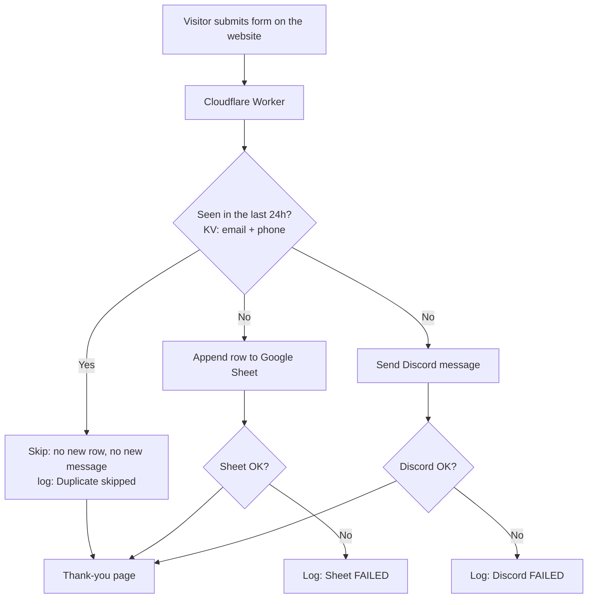

# Lumi Aesthetics – Lead Capture Automation

A lead-capture automation for a fictional aesthetic clinic ("Lumi Aesthetics"). A visitor fills in the booking form on the website, and within seconds the lead lands in a Google Sheet **and** pings a Discord channel, then the visitor sees a thank-you page.

- **Live site:** https://lumi-aesthetics.pages.dev
- **Worker endpoint:** https://lumi-lead-capture.seankobe.workers.dev (POST only)

## What it does

1. Visitor opens the multi-page clinic website and clicks **Book Consultation**.
2. A two-step form collects name, email, phone and what they're interested in (Botox, Fillers, Skin rejuvenation).
3. The form posts to a Cloudflare Worker.
4. The Worker cleans the data, checks for a duplicate, then writes the lead to Google Sheets and sends a Discord message. The two are independent, so one failing never blocks the other.
5. The visitor is sent to the thank-you page.

## Flow



## Tech used

| Piece | Tool |
|---|---|
| Website | Static HTML, CSS and vanilla JS, hosted on Cloudflare Pages |
| Backend | Cloudflare Worker (JavaScript) |
| Duplicate memory | Cloudflare Workers KV |
| Lead storage | Google Sheets API, authenticated with a service account (JWT signed inside the Worker) |
| Notifications | Discord incoming webhook |
| Logs | Cloudflare Workers Logs (Observability) |
| Secrets | Wrangler secrets, never committed |

## Handling bad and messy input

Every field is trimmed and capped at 300 characters. Missing values get a placeholder instead of breaking the flow:

| Missing | Saved as |
|---|---|
| Name | `(no name)` |
| Email | `(no email)` |
| Phone | `(no phone)` |
| Answer | `(no answer)` |

Apostrophes and emoji (for example `Maria O'Brien 🌸`) pass through to both the Sheet and Discord unchanged.

## Duplicate handling

Each lead gets a fingerprint of `lowercased email + digits-only phone`. The Worker stores it in KV for 24 hours. If the same fingerprint arrives again, no second row is added and no second Discord message is sent. The visitor still gets a normal thank-you, and the log shows `Duplicate skipped`.

Known limits, on purpose for this scope:
- The same email with a different (or missing) phone counts as a new lead.
- The window is 24 hours, then the same lead can be recorded again.

## Failure handling

The Sheet and Discord steps each have their own `try/catch`:

- **Discord fails** (for example a broken webhook URL): the lead is still saved to the Sheet, and the log shows `Discord FAILED: Discord error: 404`.
- **Sheet fails:** Discord still notifies, and the log shows `Sheet FAILED`.
- **Both fail:** the Worker logs the full lead as `LEAD NOT SAVED ANYWHERE` so it can be recovered from the logs, and returns a 500.

## Tested scenarios

| # | Scenario | Result |
|---|---|---|
| 1 | Normal lead | Row in Sheet + Discord message |
| 2 | Missing phone | Saved as `(no phone)` |
| 3 | Blank name | Saved as `(no name)` |
| 4 | Apostrophe + emoji | Saved and displayed correctly |
| 5 | Same lead twice | One row only, `Duplicate skipped` in log |
| 6 | Broken Discord URL | Sheet still gets the lead, error logged |
| 7 | Phone check | Site works on a phone, Discord banner arrives on the lock screen |

## Screenshots

Screenshots are in [`docs/screenshots`](docs/screenshots).

<!-- SCREENSHOTS: add image links here once the files are in docs/screenshots -->

## Run it yourself

```bash
cd worker
npm install
cp .dev.vars.example .dev.vars   # then fill in the four values below
npx wrangler kv namespace create LEADS_SEEN   # put the id in wrangler.jsonc
npx wrangler secret bulk .dev.vars
npx wrangler deploy
```

Secrets the Worker needs: `DISCORD_WEBHOOK_URL`, `GOOGLE_SERVICE_ACCOUNT_EMAIL`, `GOOGLE_PRIVATE_KEY`, `SHEET_ID`. Share the Sheet with the service account email as an editor, and name the tab `Leads`.

Deploy the site:

```bash
npx wrangler pages deploy site --project-name lumi-aesthetics
```

Set `WORKER_URL` at the top of `site/app.js` to your Worker URL.

## Notes

Lumi Aesthetics is a fictional clinic made for this project. The multi-page layout was inspired by a UXDI classmate's clinic design.
